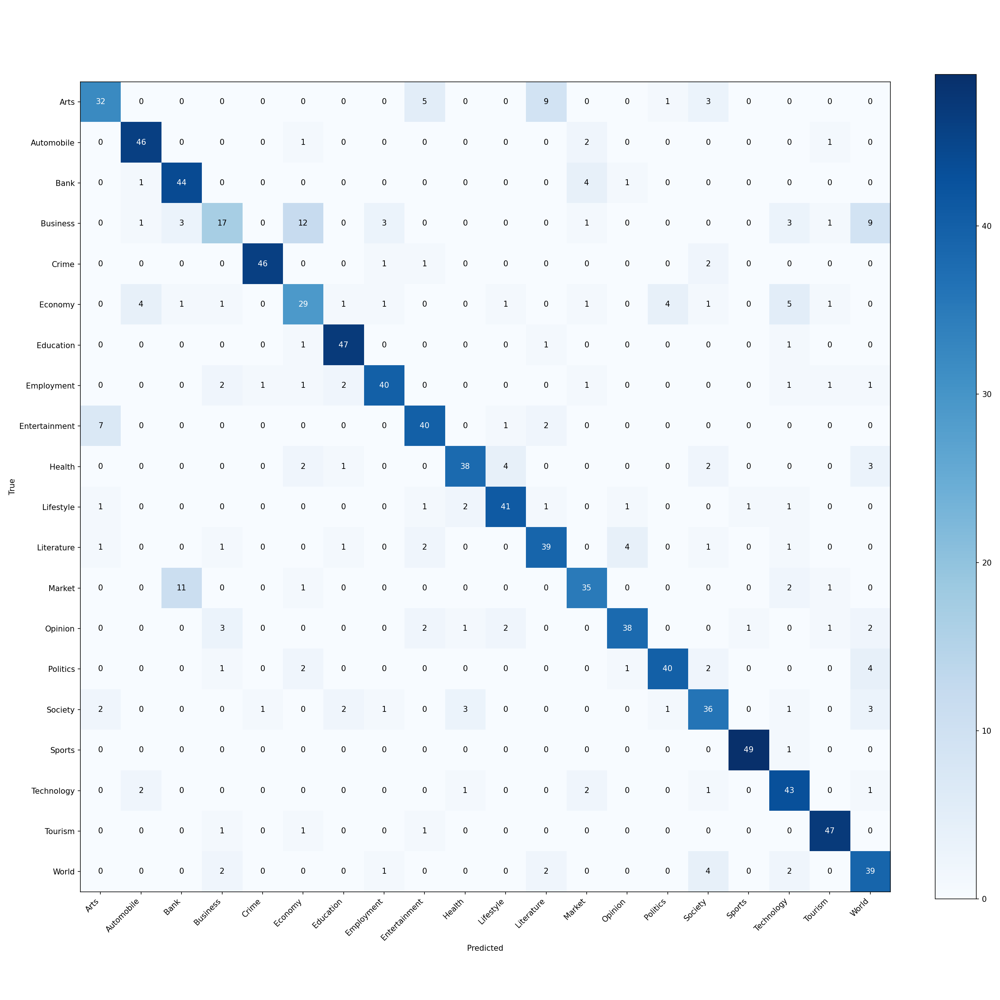

# Nepali News Classification with Multilingual Transformers

Classify Nepali news articles by topic (politics, sports, economy, ...) with a fine-tuned multilingual transformer (XLM-RoBERTa), compared against a classical TF-IDF baseline on the same data.

**Stack:** Python, scikit-learn, PyTorch, Hugging Face Transformers

## Summary

- **Task:** 20-way topic classification of Nepali news articles.
- **Data:** 10,000 articles sampled evenly (500 per topic) from the [np20ng](https://huggingface.co/datasets/Suyogyart/np20ng) corpus; 9,982 remain after removing duplicates, split 7,984 / 999 / 999 (train / validation / test).
- **Result:** fine-tuned `xlm-roberta-base` reaches **78.7% accuracy (0.783 macro-F1)** versus **77.3% (0.766)** for a TF-IDF + logistic regression baseline. The gap is small and not statistically significant (see [Results](#results)).
- **Main finding:** most errors fall between topics that overlap in meaning (Business / Economy / Bank / Market; Arts / Literature / Entertainment), and some of that is label noise in the dataset itself.

## What's inside

| Component | File | What it does |
|---|---|---|
| Preprocessing | `src/text_utils.py` | Unicode (NFC) normalisation, URL/HTML stripping, zero-width and Devanagari-digit handling, a Devanagari-safe tokenizer |
| Data | `src/data.py` | CSV loading, dedupe + label-conflict removal, rare-class filtering, deterministic stratified train/val/test split |
| Baseline | `src/baseline.py` | Word + character n-gram TF-IDF → logistic regression (scikit-learn), `C` tuned on validation macro-F1 |
| Transformer | `src/train_transformer.py` | PyTorch fine-tuning loop on Hugging Face models: AdamW, warmup + linear decay, mixed precision, grad accumulation/clipping, optional class weights, early stopping on val macro-F1 |
| Evaluation | `src/metrics.py` | Accuracy, macro/weighted F1, per-class report, confusion matrix, per-example predictions |
| Inference | `src/predict.py` | Classify text from the command line with either model |
| Comparison | `src/compare.py` | Markdown table of all runs |
| Data sampling | `scripts/prepare_np20ng.py` | Draws a class-balanced sample from the full np20ng CSV |

Both models use the same seed-controlled split, so their test scores are directly comparable.

## Setup

```bash
python -m venv .venv && source .venv/bin/activate
pip install -r requirements.txt
```

Run all commands from the project root (the saved baseline refers to `src.text_utils`).

Fine-tuning XLM-RoBERTa-base needs a GPU in practice. It ran in about 2.5 minutes per epoch on a free Colab GPU, but is impractical on an 8 GB laptop.

## Data

The project uses **np20ng**, a corpus of 200,000+ Nepali news articles in 20 categories from 10 news sources (Apache-2.0 licence per the dataset page; access is gated, so you need a free Hugging Face account and must accept its conditions). Its labels were assigned automatically from each news site's own category pages, so they are noisy (see [Error analysis](#error-analysis)). The CSV has the columns `source`, `category`, `heading`, `content`.

The data files are not included in this repository. To reproduce:

1. Download `np20ng.csv` from the dataset page into `data/`.
2. Create a balanced 10,000-article sample (500 per category):

   ```bash
   python scripts/prepare_np20ng.py data/np20ng.csv data/news.csv 10000
   ```

Any other CSV works too, with one article per row, a text column and a label column (names configurable with `--text_col` / `--label_col`). Classes with fewer than 10 examples are dropped:

```csv
text,label
"प्रधानमन्त्रीले संसदमा ...",politics
```

### Smoke test on a toy dataset

```bash
python scripts/make_sample_data.py     # writes data/sample_news.csv (270 templated sentences)
python -m src.baseline --data data/sample_news.csv
```

The toy file is templated, so every split shares the same sentences and scores are near-perfect. It only checks that the pipeline runs; it says nothing about real accuracy.

## Train

```bash
# 1. Baseline
python -m src.baseline --data data/news.csv --output_dir outputs/baseline

# 2. Transformer (GPU recommended); the reported run used these settings
python -m src.train_transformer --data data/news.csv --model_name xlm-roberta-base \
    --max_length 256 --batch_size 16 --epochs 3 --lr 2e-5 --class_weights

# 3. Compare
python -m src.compare
```

Each run writes to `outputs/<name>/`: `test_metrics.json`, `test_classification_report.txt`, `test_confusion_matrix.png`, `test_predictions.csv` (for error analysis), `labels.json`, `run_config.json`, and the model (`model.joblib` or `best/`). Transformer runs also save `history.json` (per-epoch loss and validation metrics).

**Settings of the reported runs** (both `seed=42`, same split):

| | Baseline | XLM-RoBERTa |
|---|---|---|
| Model | Word (1–2-gram) + char (2–5-gram) TF-IDF → logistic regression | `xlm-roberta-base`, fine-tuned end to end |
| Tuning | `C` ∈ {1, 3, 10, 30} on validation macro-F1 → `C=30` | 3 epochs, lr 2e-5, weight decay 0.01, 10% warmup, batch 16, max length 256, fp16 |
| Model selection | Best validation macro-F1 (0.779) | Best validation macro-F1 (0.799, epoch 3) |

Models worth trying (`--model_name`): `xlm-roberta-base`, `bert-base-multilingual-cased`, and Indic-language models such as `google/muril-base-cased`. Check each model card for Nepali coverage. For long articles, raise `--max_length` (up to 512) and reduce `--batch_size`, using `--grad_accum` to keep the effective batch size.

## Predict

```bash
python -m src.predict --model outputs/baseline/model.joblib --text "नेपाली क्रिकेट टोलीले जित्यो"
python -m src.predict --model outputs/xlm-roberta-base/best --file headlines.txt --top_k 3
```

The `best/` model folder (about 1 GB) is not stored in this repository; retrain or copy it from your training machine.

## Results

Held-out test set: 999 articles, about 50 per category.

| Model | Accuracy | Macro-F1 | Weighted-F1 |
|---|---|---|---|
| TF-IDF + LogReg | 0.7728 | 0.7659 | 0.7659 |
| xlm-roberta-base | 0.7868 | 0.7828 | 0.7828 |

XLM-RoBERTa's validation macro-F1 rose each epoch (0.681 → 0.780 → 0.799) and was still improving when training stopped at epoch 3, so more epochs might help.

**Is the gap real?** On the 999 test articles, 709 were classified correctly by both models and 150 incorrectly by both. XLM-RoBERTa alone was right on 77 articles and the baseline alone on 63. A paired exact test (McNemar) gives p = 0.27, so the difference is **not statistically significant**. This is a single run with one seed. Treat the transformer as "comparable, slightly ahead", not "clearly better".

### Per-category F1 (selected)

| Category | Baseline | XLM-R | Change |
|---|---|---|---|
| Economy | 0.395 | 0.580 | +0.19 |
| Lifestyle | 0.750 | 0.837 | +0.09 |
| Tourism | 0.852 | 0.913 | +0.06 |
| Employment | 0.771 | 0.825 | +0.05 |
| Crime | 0.889 | 0.939 | +0.05 |
| Sports | 0.970 | 0.970 | 0.00 |
| Opinion | 0.874 | 0.800 | −0.07 |
| Market | 0.800 | 0.729 | −0.07 |
| Business | 0.518 | 0.436 | −0.08 |
| Technology | 0.869 | 0.775 | −0.09 |

With only 50 test articles per category, changes of about 0.05–0.08 are a handful of articles and may be noise. Full reports and confusion matrices are in [`results/`](results/):

- `results/baseline_classification_report.txt`, `results/baseline_confusion_matrix.png`
- `results/xlm-roberta-base_classification_report.txt`, `results/xlm-roberta-base_confusion_matrix.png`



## Error analysis

- **Easy topics:** Sports (0.97 F1 for both models), Crime, Education, Tourism and Automobile are classified reliably.
- **Economy improved most.** The baseline sent 12 of 50 Economy articles to Bank; XLM-RoBERTa sends 1. Economy recall rose from 0.34 to 0.58.
- **Business is hard for both models** (17/50 correct for XLM-R, 22/50 for the baseline). Both send 9 Business articles to World, and 8 of those 9 are the *same* articles. Reading them, many are international news (for example a Putin–Xi video call, the Taliban takeover and Kabul airport crowds) filed under Business, which points to label noise from the source site's section structure rather than a model failure.
- **Market ↔ Bank:** the baseline confuses these evenly (6 each way); XLM-RoBERTa sends more Market articles to Bank (11 vs 6).
- **Arts, Literature and Entertainment overlap** (for example 9–10 Arts articles are labelled Literature by either model, and 5–7 as Entertainment).
- **Takeaway:** the remaining errors sit mostly between categories that genuinely overlap, and np20ng's labels come from each website's own sections, so some articles have no single correct topic.

## Limitations

- Single run, single seed; no confidence intervals beyond the paired test above.
- 999 test articles (about 50 per category), so per-category numbers are noisy.
- Trained on a 10,000-article class-balanced sample of a 200,000+ article corpus; real news is not class-balanced.
- Labels are derived automatically from site sections, which adds noise and caps achievable accuracy.
- Articles are truncated to 256 tokens (median article length is about 1,350 characters).
- Only 3 epochs; validation was still improving.

## Design notes

- **Devanagari tokenization.** Python's `\w` doesn't match vowel signs (matras), so scikit-learn's default token pattern cuts Nepali words in half. The baseline uses a whitespace/punctuation tokenizer that also splits on the danda (।). A unit test covers this.
- **No leakage.** Exact-duplicate articles are removed before splitting, and texts that appear under conflicting labels are dropped.
- **Macro-F1 for model selection.** News topics are often imbalanced in practice; accuracy alone hides weak minority classes. `--class_weights` re-weights the loss if needed (it has almost no effect here because the sample is balanced).
- **Reproducibility.** The seed controls the split, initialisation and shuffling; `run_config.json` records every run's settings.

## Tests

```bash
python -m pytest -q
```

## Ideas to extend

- Multi-seed runs to report mean ± std, and more epochs (validation was still improving).
- Compare more multilingual models (`google/muril-base-cased`, `bert-base-multilingual-cased`) or continue pre-training on unlabeled Nepali news.
- Merge or relabel overlapping categories (for example Business/Economy/Market/Bank) and re-evaluate.
- Wrap `src/predict.py` in a small FastAPI or Gradio demo.
